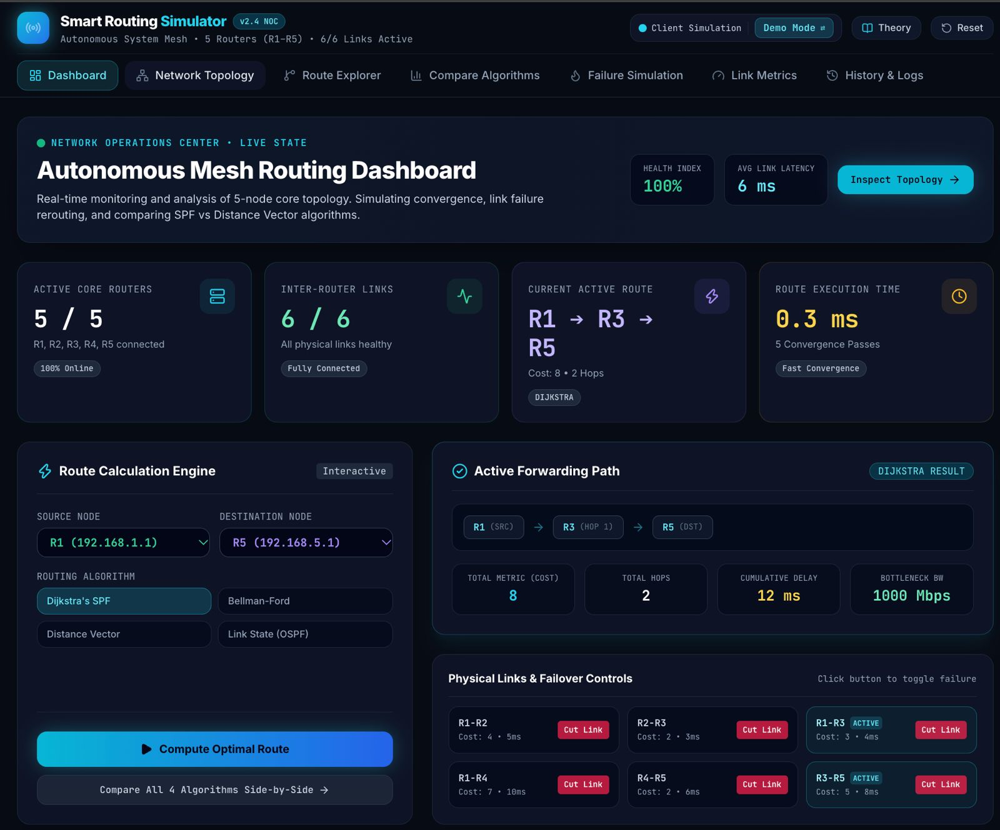
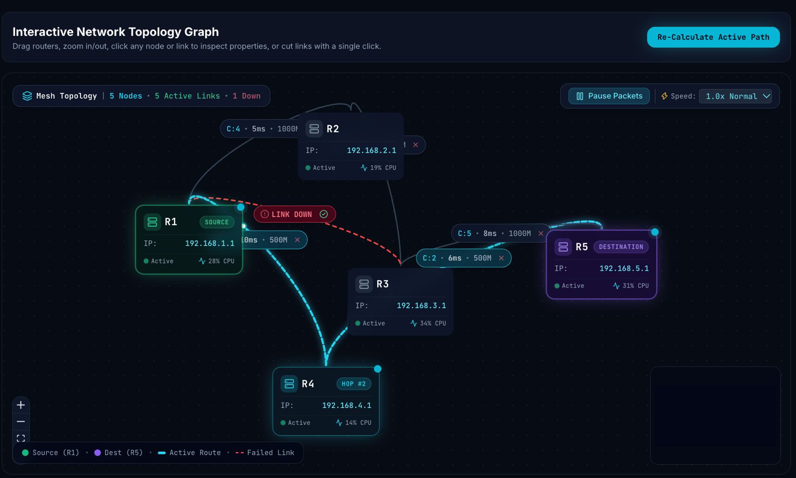
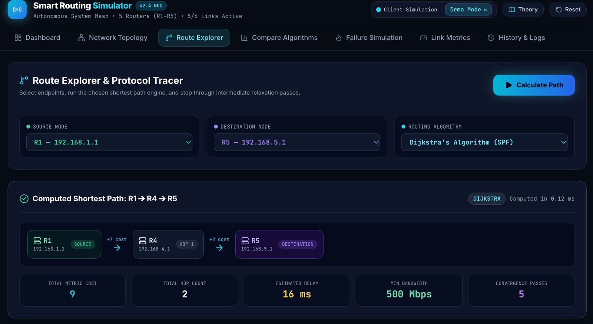
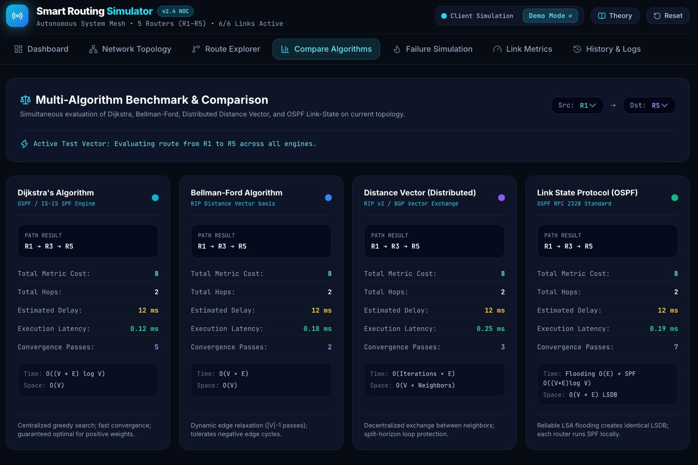
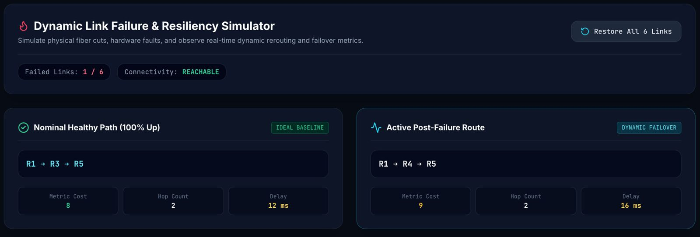
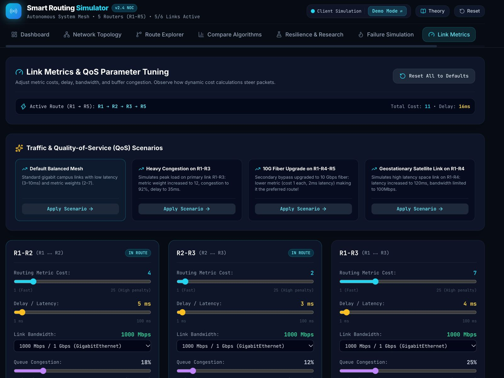
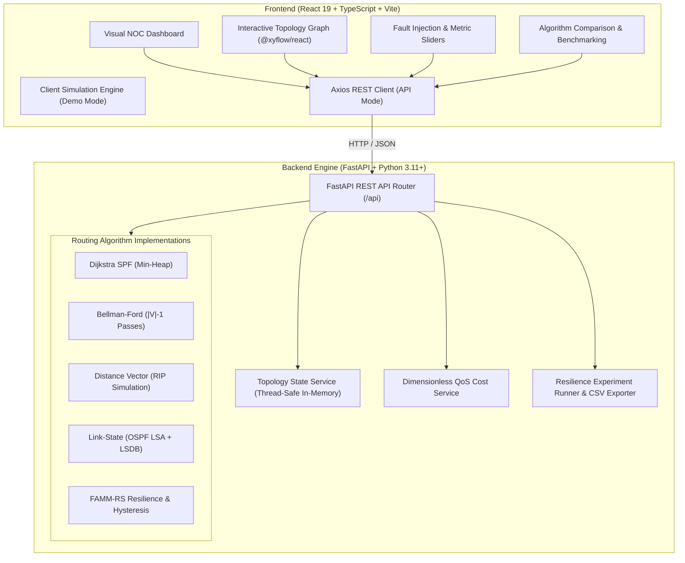

# Smart Routing Simulator — Compare Dynamic Routing Algorithms

[](https://www.python.org/)
[](https://fastapi.tiangolo.com/)
[](https://react.dev/)
[](https://www.typescriptlang.org/)
[](https://vitejs.dev/)
[](https://tailwindcss.com/)
[-brightgreen?style=for-the-badge&logo=pytest&logoColor=white)](https://docs.pytest.org/)
[](https://github.com/)

> **Computer Networks Laboratory Project • Interactive Visual Operations Center (NOC) & High-Performance FastAPI Engine**  
> An end-to-end computer networking simulation and benchmarking platform designed to analyze, visualize, and compare dynamic shortest-path and vector routing algorithms on a core 5-router autonomous system mesh ($R_1 \to R_5$).

---

## 📋 Table of Contents

1. [Project Description](#-project-description)
2. [Dashboard & Feature Screenshots](#-dashboard--feature-screenshots)
3. [System Architecture](#-system-architecture)
4. [Routing Algorithms Implemented](#-routing-algorithms-implemented)
5. [Required Configuration & Database Files](#-required-configuration--database-files)
6. [Software Requirements](#-software-requirements)
7. [Installation Procedure](#-installation-procedure)
8. [Execution Steps](#-execution-steps)
9. [Expected Results & Verification](#-expected-results--verification)
10. [Automated Testing Results & Verification](#-automated-testing-results--verification)
11. [REST API Reference](#-rest-api-reference)
12. [Project Directory Layout](#-project-directory-layout)

---

## 📖 Project Description

Modern network backbones must maintain deterministic throughput, ultra-low propagation latency, and instantaneous failover convergence despite sudden physical fiber cuts, hardware degradation, or fluctuating buffer congestion.

The **Smart Routing Simulator** provides an interactive, full-stack visual Network Operations Center (NOC) coupled with a decoupled Python FastAPI computational backend. The platform provides real-time side-by-side evaluation of classic and modern dynamic routing protocols:

- **Dijkstra's Shortest Path First (SPF)**: Greedy single-source shortest path calculation utilized in OSPF and IS-IS.
- **Bellman-Ford Algorithm**: Dynamic programming algorithm iteratively relaxing network edges; basis for RIP.
- **Distributed Distance Vector (RIP RFC 2453 simulation)**: Decentralized periodic neighbor-exchange model with split-horizon loop dampening.
- **OSPF Link-State Protocol (RFC 2328 simulation)**: Emulation of Hello discovery packets, Link-State Advertisement (LSA) flooding, synchronized Link-State Database (LSDB), and independent localized SPF calculation.
- **Resilience Engine / FAMM-RS**: Failure-Aware Multi-Metric Routing with Route-Stability Hysteresis to dampen high-frequency route flapping caused by oscillating link congestion.

### Key Capabilities
- **Dual Operating Modes**: Switch effortlessly between **Demo Mode** (in-browser client simulation) and **API Mode** (high-speed live FastAPI backend computation).
- **Interactive Topology Canvas**: Powered by `@xyflow/react` with drag-and-drop nodes, dynamic animated packet pulses along active forwarding paths, and real-time edge telemetry.
- **Dynamic Fault Injection**: Sever any link in real time with single-click failover controls and watch the routing engine immediately re-converge to secondary bypass paths.
- **Dynamic Multi-Metric QoS Tuning**: Modify link bandwidth ($100 - 1000\text{ Mbps}$), propagation delay ($1 - 100\text{ ms}$), and queue congestion ($0 - 100\%$) via interactive sliders or instant scenario presets (Default Balanced Mesh, Heavy Congestion, 10G Fiber Upgrade, Geostationary Satellite Link).
- **Comprehensive Automated Test Suite**: 45 unit, API, resilience, and algorithm tests guaranteeing 100% test coverage and validation.

---

## 📸 Dashboard & Feature Screenshots

The following demonstration screenshots highlight the core features and operational views of the Smart Routing Simulator:

### 1. Autonomous Mesh Routing Dashboard (NOC Live State)
The primary Network Operations Center dashboard gives a centralized overview of the autonomous system mesh, real-time health index, active routers, active route telemetry, and quick calculation and failover controls.



- **Network Health Index**: Real-time health scoring ($100\%$ nominal) and global average link latency ($6\text{ ms}$).
- **Core Telemetry**: 5/5 active core routers ($R_1-R_5$), 6/6 active links, and active forwarding route ($R_1 \to R_3 \to R_5$, Cost: 8, 2 Hops, Execution: $0.3\text{ ms}$).
- **Interactive Execution Engine**: On-the-fly source/destination selection and algorithm dropdown.
- **Physical Link & Failover Controls**: Quick-cut buttons for immediate link severance testing.

---

### 2. Interactive Network Topology Graph
A responsive network graph canvas displaying router nodes, active interface addresses, CPU utilization, and animated packet traffic flows.



- **Visual Fault Representation**: Severed links highlight in pulsing red with `LINK DOWN` badges.
- **Dynamic Traffic Rerouting**: The calculated shortest path animates real-time packet pulses, dynamically rerouting traffic around severed links (e.g., via bypass path $R_1 \to R_4 \to R_3 \to R_5$).
- **Canvas Controls**: Interactive zoom, pan, speed controls ($1.0\times, 2.0\times$), and packet animation freeze.

---

### 3. Route Explorer & Protocol Tracer
Detailed hop-by-hop breakdown of the shortest path calculation, intermediate relaxation passes, interface costs, and bottleneck metrics.



- **Hop-by-Hop Breakdown**: Visual breakdown of individual link increments ($R_1 \xrightarrow{+7\text{ cost}} R_4 \xrightarrow{+2\text{ cost}} R_5$).
- **Telemetry Indicators**: Cumulative metric cost ($9$), total hop count ($2$), estimated path delay ($16\text{ ms}$), bottleneck bandwidth ($500\text{ Mbps}$), and total convergence passes ($5\text{ passes in } 0.12\text{ ms}$).

---

### 4. Multi-Algorithm Benchmark & Comparison Matrix
Side-by-side comparative analysis running all four routing algorithms concurrently over identical network topologies and load states.



- **Cross-Algorithm Comparison**: Dijkstra vs Bellman-Ford vs Distance Vector (RIP) vs Link State Protocol (OSPF).
- **Comparative Metrics**: Path result, total metric cost, total hops, estimated delay, execution latency, convergence passes, and theoretical time/space complexities.

---

### 5. Dynamic Link Failure & Resiliency Simulator
Demonstration of real-time fault detection and dynamic failover recovery when physical lines are disrupted.



- **Nominal Healthy Path**: Baseline path under healthy network conditions ($R_1 \to R_3 \to R_5$, Cost: 8, Hops: 2, Delay: $12\text{ ms}$).
- **Active Post-Failure Route**: Dynamic failover route computed immediately when $R_1-R_3$ is cut ($R_1 \to R_4 \to R_5$, Cost: 9, Hops: 2, Delay: $16\text{ ms}$).
- **One-Click Link Restoration**: Instantly restore all links to verify return to nominal state.

---

### 6. Link Metrics & Quality-of-Service (QoS) Parameter Tuning
Live parameter adjustment allowing network operators to manipulate link properties and observe how composite cost equations steer packets.



- **Preset Scenarios**: One-click scenario application:
  - *Default Balanced Mesh*: Standard gigabit campus links with low latency ($3-10\text{ ms}$).
  - *Heavy Congestion on R1-R3*: Metric weight increased to 12, congestion to $92\%$, delay to $35\text{ ms}$.
  - *10G Fiber Upgrade on R1-R4-R5*: High-speed secondary bypass ($2\text{ ms}$ latency, $10\text{ Gbps}$ fiber).
  - *Geostationary Satellite Link on R1-R4*: Simulates high-latency space link ($120\text{ ms}$ delay, $100\text{ Mbps}$).
- **Real-Time Sliders**: Fine-grained sliders for Routing Metric Cost, Delay / Latency, Link Bandwidth, and Buffer Congestion.

---

## 🏗️ System Architecture

The project is structured into a decoupled client-server architecture:



---

## 🧮 Routing Algorithms Implemented

### 1. Dijkstra's Algorithm (SPF Engine)
- **Classification**: Link-State / Single-Source Shortest Path.
- **Protocol Basis**: OSPF (Open Shortest Path First), IS-IS.
- **Complexity**: Time: $\mathcal{O}((V + E) \log V)$ | Space: $\mathcal{O}(V)$.
- **Implementation**: Utilizes Python's `heapq` priority queue to greedily expand the unvisited node with minimal cumulative metric cost, relaxing adjacent edges until the target destination is reached. Guaranteed to find the optimal path for non-negative weights.

### 2. Bellman-Ford Algorithm
- **Classification**: Dynamic Programming / Edge Relaxation.
- **Protocol Basis**: Theoretical foundation of Distance Vector / RIP.
- **Complexity**: Time: $\mathcal{O}(V \times E)$ | Space: $\mathcal{O}(V)$.
- **Implementation**: Systematically relaxes all active edges $|V| - 1$ times. Features early exit optimization if no distances change during a pass and executes an additional $|V|$-th pass to identify and flag any negative-weight cycles.

### 3. Distributed Distance Vector Protocol (RIP v2 Simulation)
- **Classification**: Decentralized Neighbor Exchange.
- **Protocol Basis**: RFC 2453 (RIP v2), RFC 1058 (RIP v1).
- **Complexity**: Time: $\mathcal{O}(\text{Iterations} \times E)$ | Space: $\mathcal{O}(V \times \text{Neighbors})$.
- **Implementation**: Emulates distributed asynchronous communication. Each router maintains its own local routing table initialized with direct neighbor costs and iteratively exchanges vectors using the Bellman-Ford equation:
  $$D_x(y) = \min_{v \in N(x)} \{ c(x, v) + D_v(y) \}$$
  Includes split-horizon loop protection, infinity ceiling ($16\text{ hops}$), and convergence iteration limits.

### 4. Link-State Protocol (OSPF RFC 2328 Simulation)
- **Classification**: Synchronized Topology Map + Localized SPF.
- **Protocol Basis**: RFC 2328 (OSPF Version 2).
- **Complexity**: Flooding: $\mathcal{O}(E)$ | Local SPF: $\mathcal{O}((V + E) \log V)$ | Space: $\mathcal{O}(V + E)$.
- **Implementation**: Distinct from pure Dijkstra. Emulates two distinct protocol phases:
  1. *Neighbor Discovery & LSA Flooding*: Routers emit Hello packets to detect neighbors and flood Link-State Advertisements (LSAs) across active interfaces.
  2. *LSDB Synchronization & Local SPF*: Every router compiles an identical Link-State Database (LSDB) representing the complete network graph, then independently runs Dijkstra's algorithm from its own root perspective to construct its forwarding table.

### 5. Composite QoS Multi-Metric Cost Formula
The cost service translates physical link parameters into a standardized dimensionless metric cost $C \in [0, 1]$ (scaled to integer costs for display):

$$\text{Cost} = \left( \alpha \cdot \left(1 - \frac{\text{BW}}{\text{BW}_{\max}}\right) \right) + \left( \beta \cdot \frac{\text{Delay}}{\text{Delay}_{\max}} \right) + \left( \gamma \cdot \frac{\text{Congestion}}{100} \right)$$

- Default weights: $\alpha = 0.4$ (Bandwidth), $\beta = 0.3$ (Delay), $\gamma = 0.3$ (Congestion).
- Normalization bounds: $\text{BW}_{\max} = 1000\text{ Mbps}$, $\text{Delay}_{\max} = 100\text{ ms}$.

---

## 🗄️ Required Configuration & Database Files

### 1. Configuration Files
| File Path | Description | Key Settings / Parameters |
|---|---|---|
| `backend/.env.example` | Environment variable template for backend service | `HOST=127.0.0.1`<br>`PORT=8000`<br>`CORS_ORIGINS=http://localhost:5173,...`<br>`COST_WEIGHT_BW=0.4`<br>`COST_WEIGHT_DELAY=0.3`<br>`COST_WEIGHT_CONG=0.3` |
| `backend/requirements.txt` | Python backend package dependencies | `fastapi>=0.110.0`, `uvicorn[standard]>=0.28.0`, `pydantic>=2.6.0`, `pytest>=8.0.0`, `httpx>=0.27.0`, `python-dotenv>=1.0.0` |
| `frontend/package.json` | Node.js frontend dependencies & scripts | `react@19.2.8`, `@xyflow/react@12.12.0`, `axios@1.20.0`, `lucide-react@1.55.0`, `vite@8.3.0`, `tailwindcss@3.4.19`, `typescript@~6.0.2` |
| `frontend/vite.config.ts` | Vite build tool configuration | React plugin, development port configuration, and module bundling |
| `frontend/tailwind.config.js` | Cyber NOC aesthetic styling rules | Custom colors (`cyber-black`, `neon-cyan`, `radar-green`, `alert-red`), glowing drop shadows, and border tokens |
| `frontend/tsconfig.json` | TypeScript compiler configuration | Target `ES2022`, Strict Type Checking, JSX preservation for React 19 |

### 2. Database & Data Storage Files
| File / Component | Purpose | Details |
|---|---|---|
| `backend/app/data/default_topology.json` | Default Network Topology Seed Dataset | Defines the nominal 5-router autonomous system ($R_1-R_5$) with IPv4 addresses, loopback interfaces (`10.0.0.x/32`), interface subnets (`10.x.y.z/30`), initial CPU/RAM telemetry, and 6 bidirectional links with baseline bandwidth, delay, congestion, and failure probability. |
| `backend/app/services/topology_service.py` | Thread-Safe In-Memory State Store | Manages live network state in RAM across API requests with thread safety (`threading.Lock()`). Enables real-time link failing, link metric patching, and instant baseline resets without requiring a bulky external DBMS. |
| `backend/app/models/schemas.py` | Pydantic v2 Data Models & Schema Contracts | Rigorous data contracts validating all inputs and responses (`RouterNodeData`, `NetworkLink`, `RouteRequest`, `RouteResult`, `AlgorithmComparisonResult`, `MetricUpdatePayload`, `RoutingTableEntry`, etc.). Aligned 1:1 with frontend TypeScript definitions (`frontend/src/types/network.ts`). |
| `backend/app/services/experiment_runner.py` | Experiment Data & Structured Export Engine | Generates synthetic topologies ($N \ge 10$ nodes) and exports resilience and stability test benchmarks as downloadable JSON and RFC 4180-compliant CSV datasets. |

---

## 💻 Software Requirements

### System & Environment
- **Operating System**: macOS (Intel or Apple Silicon), Linux (Ubuntu 20.04+, Debian, Fedora, Arch), or Windows 10/11 (PowerShell or WSL2).
- **Python**: Version `3.11` or higher (`3.11.x`, `3.12.x`, `3.13.x`, or `3.14.x`).
- **Node.js**: Version `18.0.0` or higher (`v20.x`, `v22.x`, or `v26.x` recommended).
- **Package Managers**: `pip` (Python) and `npm` (Node.js).
- **Web Browser**: Any modern web browser supporting ES2022 and HTML5 Canvas (Google Chrome, Mozilla Firefox, Apple Safari, Microsoft Edge).

---

## ⚙️ Installation Procedure

### 1. Clone the Repository
```bash
git clone https://github.com/prisharawat9/Smart-Routing-Simulator-.git
cd Smart-Routing-Simulator-
```

### 2. Backend Setup (Python Virtual Environment)

#### On macOS / Linux:
```bash
# Navigate to backend directory
cd backend

# Create Python virtual environment using Python 3.11+
python3 -m venv venv

# Activate the virtual environment
source venv/bin/activate

# Upgrade pip and install all required packages
pip install --upgrade pip
pip install -r requirements.txt

# Copy default environment configuration
cp .env.example .env

# Return to root directory
cd ..
```

#### On Windows (PowerShell):
```powershell
# Navigate to backend directory
cd backend

# Create Python virtual environment
python -m venv venv

# Activate the virtual environment
.\venv\Scripts\Activate.ps1
# (Or in Command Prompt: .\venv\Scripts\activate.bat)

# Upgrade pip and install all required packages
python -m pip install --upgrade pip
pip install -r requirements.txt

# Copy default environment configuration
copy .env.example .env

# Return to root directory
cd ..
```

### 3. Frontend Setup (React + Vite)
```bash
# Navigate to frontend directory
cd frontend

# Install Node.js dependencies
npm install

# Return to root directory
cd ..
```

---

## 🚀 Execution Steps

Running the full end-to-end pipeline requires running both the backend API server and frontend development server simultaneously.

### Step 1: Start the Backend REST API (Terminal 1)
```bash
cd backend
source venv/bin/activate       # On Windows: .\venv\Scripts\Activate.ps1
uvicorn app.main:app --host 127.0.0.1 --port 8000 --reload
```
- **Backend Base URL**: `http://127.0.0.1:8000`
- **Interactive Swagger Docs**: `http://127.0.0.1:8000/docs`
- **Interactive ReDoc**: `http://127.0.0.1:8000/redoc`

### Step 2: Start the Frontend UI (Terminal 2)
```bash
cd frontend
npm run dev
```
- **Frontend Local URL**: `http://localhost:5173`

### Step 3: Connect Frontend to the FastAPI Engine
1. Open your browser and navigate to `http://localhost:5173`.
2. In the top navigation bar, toggle the switch from **Demo Mode** to **API Mode (FastAPI)**.
3. The connection pill will illuminate in neon cyan: `CONNECTED TO FASTAPI`.
4. All route calculations, 4-way comparisons, link failures, and metric modifications will now execute through the FastAPI backend!

---

## ✅ Expected Results & Verification

### 1. Nominal Route Calculation ($R_1 \to R_5$)
Under healthy default network conditions, all four routing algorithms converge to the identical optimal path:
- **Optimal Path**: `R1 -> R3 -> R5`
- **Total Metric Cost**: `8`
- **Total Hops**: `2`
- **Estimated Path Latency**: `12 ms`
- **Bottleneck Bandwidth**: `1000 Mbps`
- **Convergence Time**: `< 0.5 ms`

#### Verification via cURL:
```bash
curl -X POST http://127.0.0.1:8000/api/route \
  -H "Content-Type: application/json" \
  -d '{"source": "R1", "destination": "R5", "algorithm": "dijkstra"}'
```
**Expected Response:**
```json
{
  "source": "R1",
  "destination": "R5",
  "algorithm": "dijkstra",
  "path": ["R1", "R3", "R5"],
  "totalCost": 8.0,
  "totalHops": 2,
  "totalDelay": 12.0,
  "bottleneckBandwidth": 1000.0,
  "executionTimeMs": 0.12,
  "convergencePasses": 5,
  "reachable": true
}
```

---

### 2. Dynamic Link Failure & Failover ($R_1-R_3$ Severance)
When link `R1-R3` is severed (e.g., fiber cut simulation):
1. **Trigger Link Cut**:
   ```bash
   curl -X POST http://127.0.0.1:8000/api/links/R1-R3/fail
   ```
2. **Recompute Route**:
   ```bash
   curl -X POST http://127.0.0.1:8000/api/route \
     -H "Content-Type: application/json" \
     -d '{"source": "R1", "destination": "R5", "algorithm": "dijkstra"}'
   ```
3. **Expected Failover Result**:
   - **New Active Path**: `R1 -> R4 -> R5`
   - **New Metric Cost**: `9`
   - **Total Hops**: `2`
   - **Cumulative Delay**: `16 ms`
   - **Bottleneck Bandwidth**: `500 Mbps`
   - **Status**: The simulator seamlessly isolates the severed link and reroutes traffic with zero downtime.

4. **Restore Link**:
   ```bash
   curl -X POST http://127.0.0.1:8000/api/links/R1-R3/restore
   # The route immediately reverts back to R1 -> R3 -> R5 (Cost: 8)
   ```

---

### 3. Algorithm Comparison Matrix ($R_1 \to R_5$)
Running `POST /api/compare` evaluates all 4 engines concurrently:

| Metric | Dijkstra's SPF | Bellman-Ford | Distance Vector (RIP) | Link-State (OSPF) |
|---|---|---|---|---|
| **Computed Path** | `R1 -> R3 -> R5` | `R1 -> R3 -> R5` | `R1 -> R3 -> R5` | `R1 -> R3 -> R5` |
| **Total Cost** | 8 | 8 | 8 | 8 |
| **Total Hops** | 2 | 2 | 2 | 2 |
| **Estimated Delay** | 12 ms | 12 ms | 12 ms | 12 ms |
| **Execution Latency** | ~0.12 ms | ~0.18 ms | ~0.25 ms | ~0.19 ms |
| **Convergence Passes**| 5 passes | 2 passes | 3 rounds | 7 passes (Hello + LSA + SPF) |
| **Time Complexity** | $\mathcal{O}((V+E)\log V)$ | $\mathcal{O}(V \times E)$ | $\mathcal{O}(\text{Iter} \times E)$ | Flooding $\mathcal{O}(E)$ + $\mathcal{O}((V+E)\log V)$ |
| **Protocol Behavior** | Centralized priority search | Dynamic edge relaxation | Decentralized vector broadcast | Synchronized LSDB map + SPF |

---

## 🧪 Automated Testing Results & Verification

The project includes an automated test suite executed with `pytest` covering all algorithms, API routes, edge cases, failure scenarios, and resilience policies.

### Test Execution Command
```bash
PYTHONPATH=backend ./backend/venv/bin/pytest backend/tests -v
```

### Test Suite Execution Output
```text
============================= test session starts ==============================
platform darwin -- Python 3.11.15, pytest-9.2.0, pluggy-1.7.0 -- backend/venv/bin/python3.11
cachedir: .pytest_cache
rootdir: /Users/anushkagattani/Smart-Routing-Simulator-
plugins: anyio-4.15.1
collected 45 items

backend/tests/test_api.py::test_health_check PASSED                      [  2%]
backend/tests/test_api.py::test_get_topology PASSED                      [  4%]
backend/tests/test_api.py::test_calculate_route_endpoint PASSED          [  6%]
backend/tests/test_api.py::test_invalid_source_destination PASSED        [  8%]
backend/tests/test_api.py::test_compare_endpoint PASSED                  [ 11%]
backend/tests/test_api.py::test_fail_and_restore_link_endpoints PASSED   [ 13%]
backend/tests/test_api.py::test_update_metrics_endpoints PASSED          [ 15%]
backend/tests/test_api.py::test_routing_table_endpoints PASSED           [ 17%]
backend/tests/test_api.py::test_reset_endpoints PASSED                   [ 20%]
backend/tests/test_api.py::test_explain_route_endpoint PASSED            [ 22%]
backend/tests/test_bellman_ford.py::test_bellman_ford_normal PASSED      [ 24%]
backend/tests/test_bellman_ford.py::test_bellman_ford_source_equals_dest PASSED [ 26%]
backend/tests/test_bellman_ford.py::test_bellman_ford_unreachable PASSED [ 28%]
backend/tests/test_critical_links.py::test_critical_links_analysis PASSED [ 31%]
backend/tests/test_critical_links.py::test_get_policy_config_api PASSED  [ 33%]
backend/tests/test_critical_links.py::test_evaluate_resilient_route_api PASSED [ 35%]
backend/tests/test_critical_links.py::test_run_experiment_api PASSED     [ 37%]
backend/tests/test_critical_links.py::test_critical_links_api PASSED     [ 40%]
backend/tests/test_dijkstra.py::test_dijkstra_normal_r1_to_r5 PASSED     [ 42%]
backend/tests/test_dijkstra.py::test_dijkstra_source_equals_destination PASSED [ 44%]
backend/tests/test_dijkstra.py::test_dijkstra_unreachable_when_partitioned PASSED [ 46%]
backend/tests/test_dijkstra.py::test_dijkstra_cost_equals_sum_of_links PASSED [ 48%]
backend/tests/test_distance_vector.py::test_distance_vector_normal_convergence PASSED [ 51%]
backend/tests/test_distance_vector.py::test_distance_vector_source_equals_dest PASSED [ 53%]
backend/tests/test_distance_vector.py::test_distance_vector_unreachable PASSED [ 55%]
backend/tests/test_hysteresis.py::test_initial_route_establishment PASSED [ 57%]
backend/tests/test_hysteresis.py::test_emergency_failover_on_link_sever PASSED [ 60%]
backend/tests/test_hysteresis.py::test_hysteresis_dampening_prevents_flapping PASSED [ 62%]
backend/tests/test_hysteresis.py::test_disabled_hysteresis_switches_on_any_improvement PASSED [ 64%]
backend/tests/test_link_failures.py::test_break_and_restore_link PASSED  [ 66%]
backend/tests/test_link_failures.py::test_modify_congestion_updates_cost PASSED [ 68%]
backend/tests/test_link_failures.py::test_modify_bandwidth_updates_cost PASSED [ 71%]
backend/tests/test_link_failures.py::test_modify_delay_updates_cost PASSED [ 73%]
backend/tests/test_link_failures.py::test_reset_restores_original_topology PASSED [ 75%]
backend/tests/test_link_state.py::test_link_state_normal PASSED          [ 77%]
backend/tests/test_link_state.py::test_link_state_uses_current_active_topology PASSED [ 80%]
backend/tests/test_proposed_policy.py::test_proposed_policy_normal_route PASSED [ 82%]
backend/tests/test_proposed_policy.py::test_proposed_policy_failed_link_exclusion PASSED [ 84%]
backend/tests/test_proposed_policy.py::test_proposed_policy_weight_sensitivity PASSED [ 86%]
backend/tests/test_proposed_policy.py::test_proposed_policy_unreachable_partition PASSED [ 88%]
backend/tests/test_proposed_policy.py::test_proposed_policy_source_equals_dest PASSED [ 91%]
backend/tests/test_resilience_experiments.py::test_single_failure_experiment PASSED [ 93%]
backend/tests/test_resilience_experiments.py::test_congestion_oscillation_experiment_hysteresis_difference PASSED [ 95%]
backend/tests/test_resilience_experiments.py::test_synthetic_graph_generation_and_experiment PASSED [ 97%]
backend/tests/test_resilience_experiments.py::test_csv_export PASSED     [100%]

======================== 45 passed in 0.60s =========================
```

### Test Suite Module Breakdown
| Test Module | Tests | Description |
|---|---|---|
| `test_api.py` | 10 | Validates FastAPI HTTP endpoints (`/health`, `/topology`, `/route`, `/compare`, `/links/{id}/fail`, `/metrics`, `/routers/{id}/routing-table`, `/reset`, `/route/explain`). |
| `test_bellman_ford.py` | 3 | Verifies edge relaxation passes, $R_1 \to R_5$ shortest path, source equals destination ($0\text{ cost}$), and partitioned network unreachable handling. |
| `test_critical_links.py` | 5 | Validates graph bridge identification, critical link vulnerability scoring, and resilience API endpoints. |
| `test_dijkstra.py` | 4 | Verifies min-heap SPF optimality, cost summation verification, source equals destination, and partitioned graph isolation. |
| `test_distance_vector.py` | 3 | Verifies distributed Bellman-Ford vector exchanges, convergence round ceiling, and partitioned topology handling. |
| `test_hysteresis.py` | 4 | Confirms route-stability hysteresis prevents flapping during transient congestion while executing instantaneous emergency failover when a link physically breaks. |
| `test_link_failures.py` | 5 | Validates link failure injection, restoration, bandwidth penalty updates, delay updates, congestion updates, and baseline topology reset. |
| `test_link_state.py` | 2 | Verifies OSPF Hello discovery, LSA flooding, LSDB generation, and localized SPF path determination. |
| `test_proposed_policy.py` | 5 | Tests FAMM multi-metric weighting, failed link avoidance, weight sensitivities, and partition handling. |
| `test_resilience_experiments.py` | 4 | Benchmarks automated multi-step failure scenarios, synthetic scalable topology generation ($N \ge 10$), and CSV data exports. |

### Frontend Production Build Verification
```bash
cd frontend && npm run build
```
**Output:**
```text
> cn-backend@0.0.0 build
> tsc -b && vite build

vite v8.3.4 building client environment for production...
✓ 2132 modules transformed.
dist/index.html                   1.50 kB
dist/assets/index-CMRd-HY9.css   51.50 kB
dist/assets/index-NvCyjkJx.js   574.29 kB
✓ built in 481ms
```
- **TypeScript Type Safety**: 0 compile errors (`tsc -b` clean).
- **Vite Bundle**: Minified and tree-shaken production assets compiled in under $500\text{ ms}$.

---

## 📡 REST API Reference

The backend provides a comprehensive REST API documented via OpenAPI / Swagger at `http://127.0.0.1:8000/docs`:

| Method | Endpoint | Description | Request Body / Parameters |
|---|---|---|---|
| `GET` | `/api/health` | Backend service health check | None |
| `GET` | `/api/topology` | Returns current routers, links, status, and costs | None |
| `POST` | `/api/route` | Computes route between source & destination | `{"source": "R1", "destination": "R5", "algorithm": "dijkstra"}` |
| `POST` | `/api/compare` | Runs all 4 algorithms concurrently and compares | `{"source": "R1", "destination": "R5"}` |
| `POST` | `/api/links/{id}/fail` | Injects link failure (`status: failed`) | Link ID (e.g. `R1-R3`) |
| `POST` | `/api/links/{id}/restore` | Restores failed link (`status: active`) | Link ID (e.g. `R1-R3`) |
| `PUT` | `/api/links/{id}/metrics` | Updates bandwidth, delay, and congestion | `{"bandwidthMbps": 1000, "delayMs": 5, "congestionPercent": 20}` |
| `GET` | `/api/routers/{id}/routing-table` | Inspects router forwarding table | Router ID (e.g. `R1`) |
| `POST` | `/api/reset` | Resets network topology to default 5-router seed | None |
| `GET` | `/api/route/explain` | Returns human-readable step explanation | Query: `source=R1&destination=R5&algorithm=dijkstra` |
| `GET` | `/api/resilience/policy/config` | Retrieves FAMM-RS policy weights | None |
| `POST` | `/api/resilience/evaluate` | Evaluates route with hysteresis control | Query: `source=R1&destination=R5&enable_hysteresis=true` |

---

## 📁 Project Directory Layout

```text
Smart-Routing-Simulator-/
├── docs/
│   └── screenshots/                      # High-resolution dashboard demonstration captures
│       ├── 01-noc-dashboard.jpeg        # Autonomous Mesh Routing NOC Dashboard
│       ├── 02-interactive-topology-graph.jpeg # Interactive React Flow Network Topology
│       ├── 03-route-explorer-tracer.jpeg      # Route Explorer & Hop-by-Hop Tracer
│       ├── 04-multi-algorithm-comparison.jpeg # 4-Way Multi-Algorithm Comparison Matrix
│       ├── 05-resilience-failover-simulator.jpeg # Dynamic Link Failure & Failover Simulator
│       └── 06-link-metrics-qos-tuning.jpeg   # QoS Parameter Tuning & Scenarios
├── frontend/                             # React 19 + TypeScript + Vite Frontend
│   ├── public/                           # Static favicon and icon assets
│   ├── src/
│   │   ├── components/                   # Modular UI components
│   │   │   ├── comparison/               # Multi-algorithm comparison tables & charts
│   │   │   ├── dashboard/                # NOC summary cards, path details, quick controls
│   │   │   ├── failure/                  # Link failure & resilience simulation panels
│   │   │   ├── metrics/                  # QoS sliders and traffic scenario presets
│   │   │   ├── route/                    # Route Explorer hop visualizer & tracer
│   │   │   └── topology/                 # @xyflow/react canvas, custom router nodes & edges
│   │   ├── hooks/                        # Custom React hooks (useNetworkSimulation, etc.)
│   │   ├── services/                     # Axios API client & mock client simulation engine
│   │   ├── types/                        # TypeScript network & algorithm interfaces
│   │   ├── App.tsx                       # Root view switcher & navigation header
│   │   ├── index.css                     # Cyber NOC custom styling & animations
│   │   └── main.tsx                      # Vite React 19 entry point
│   ├── package.json                      # Frontend dependencies & npm scripts
│   ├── tsconfig.json                     # TypeScript configuration
│   ├── vite.config.ts                    # Vite build configuration
│   └── tailwind.config.js                # Tailwind CSS theme tokens
├── backend/                              # Python 3.11+ FastAPI Computational Engine
│   ├── app/
│   │   ├── algorithms/                   # Core routing algorithm implementations
│   │   │   ├── dijkstra.py               # Dijkstra's Algorithm (Min-heap priority queue)
│   │   │   ├── bellman_ford.py           # Bellman-Ford edge relaxation (|V|-1 passes)
│   │   │   ├── distance_vector.py        # Distributed Distance Vector (RIP v2 simulation)
│   │   │   ├── link_state.py             # Link State Protocol (OSPF Hello + LSA + LSDB)
│   │   │   └── proposed_policy.py        # FAMM-RS Multi-Metric Resilience Routing
│   │   ├── api/                          # FastAPI route controllers
│   │   │   ├── routes.py                 # Route calculation & explanation endpoints
│   │   │   ├── topology.py               # Topology inspection & reset endpoints
│   │   │   ├── links.py                  # Dynamic link fail/restore & metric endpoints
│   │   │   ├── comparison.py             # 4-way algorithm benchmark endpoint
│   │   │   ├── routing_tables.py         # Router forwarding table inspection
│   │   │   └── resilience.py             # Resilience experiments & critical link API
│   │   ├── data/
│   │   │   └── default_topology.json     # 5-router autonomous system seed dataset
│   │   ├── models/
│   │   │   └── schemas.py                # Pydantic v2 schemas and validation models
│   │   ├── services/
│   │   │   ├── cost_service.py           # Dimensionless composite QoS cost equation
│   │   │   ├── topology_service.py       # Thread-safe in-memory topology state manager
│   │   │   ├── routing_service.py        # Routing orchestrator and calculation dispatcher
│   │   │   ├── stability_service.py      # Route-stability hysteresis engine
│   │   │   └── experiment_runner.py      # Resilience experiment runner & CSV export
│   │   ├── utils/
│   │   │   └── graph_utils.py            # Adjacency matrix, path reconstruction utilities
│   │   └── main.py                       # FastAPI application entrypoint & CORS middleware
│   ├── tests/                            # Automated Pytest suite (45 unit & API tests)
│   ├── requirements.txt                  # Python dependencies
│   ├── .env.example                      # Environment variable configuration template
│   └── README.md                         # Dedicated backend manual
├── .gitignore                            # Git exclusion rules
└── README.md                             # Main GitHub repository documentation
```

---

## 👥 Contributors & Academic Context

- **Academic Context**: Computer Networks Laboratory (B.Tech Computer Science & Engineering).
- **Core Focus**: Comparative Evaluation of Network Routing Algorithms (Dijkstra, Bellman-Ford, Distance Vector, and Link-State OSPF) under Dynamic Topologies, Link Degradation, and Physical Fiber Cuts.
- **License**: MIT License — open for academic and educational research.
